# Capstone Project: “Observability-as-a-Service: Centralized Monitoring, Logging, and Automated Response for a Multi-Tier Application”

A centralized monitoring, logging, tracing, alerting, and automated remediation solution for a multi-tier application running on AWS.

The project demonstrates how DevOps engineers can use AWS CloudWatch, CloudWatch Logs Insights, EventBridge, Lambda, SNS, OpenTelemetry, and AWS CDK to improve application visibility and operational response.

---

## 1. Project Overview

This project implements an observability platform for an application consisting of:

- An Nginx web tier hosted on EC2.
- An Application Load Balancer.
- A containerized FastAPI application running on Amazon ECS Fargate.
- An Amazon RDS MySQL database.
- Centralized logging and infrastructure monitoring.
- Distributed tracing using OpenTelemetry and AWS X-Ray.
- Automated incident handling using EventBridge and Lambda.
- Operational notifications using Amazon SNS.
- Centralized log archiving using Amazon S3.

The infrastructure is deployed in AWS Region `us-east-1` using AWS CDK.

## 2. Architecture

The solution follows this operational flow:

1. Users access the application through the Application Load Balancer.
2. Traffic is routed to the web and application tiers.
3. The FastAPI application communicates with the RDS MySQL database.
4. EC2, ECS, ALB, RDS, and Lambda publish metrics to CloudWatch.
5. Application and infrastructure logs are collected in CloudWatch Logs.
6. CloudWatch metric filters and custom metrics support application-level monitoring.
7. CloudWatch alarms detect abnormal conditions.
8. EventBridge receives alarm state changes and invokes the remediation Lambda.
9. Lambda performs bounded ECS scale-out or publishes incident notifications.
10. SNS sends operational notifications to the subscribed email address.

## 3. AWS Services Used

| Service | Purpose |
|---|---|
| Amazon VPC | Network isolation |
| Amazon EC2 | Web tier hosting |
| Application Load Balancer | Application traffic distribution |
| Amazon ECS Fargate | Containerized application hosting |
| Amazon ECR | Container image storage |
| Amazon RDS MySQL | Relational database |
| Amazon CloudWatch | Metrics, logs, dashboards, and alarms |
| CloudWatch Logs Insights | Log analysis |
| AWS CloudTrail / EventBridge integration | Event-driven operational workflows |
| AWS Lambda | Automated remediation |
| Amazon SNS | Operational email notifications |
| Amazon S3 | Centralized log archiving |
| AWS X-Ray | Distributed tracing |
| AWS CDK | Infrastructure as Code |

## 4. Repository Structure

```text
centralized-observability-platform/
│
├── app/
│   ├── otel/
│   │   ├── collector-config.yaml
│   │   └── Dockerfile
│   ├── src/
│   │   ├── database.py
│   │   ├── logging_config.py
│   │   ├── main.py
│   │   ├── metrics.py
│   │   ├── models.py
│   │   ├── schemas.py
│   │   └── telemetry.py
│   ├── tests/
│   ├── Dockerfile
│   └── requirements.txt
│
├── infrastructure/
│   ├── bin/
│   ├── config/
│   ├── lib/
│   │   ├── application-stack.ts
│   │   ├── archive-stack.ts
│   │   ├── database-stack.ts
│   │   ├── ecr-stack.ts
│   │   ├── network-stack.ts
│   │   ├── remediation-stack.ts
│   │   └── web-stack.ts
│   ├── test/
│   ├── cdk.json
│   └── package.json
│
├── monitoring/
│   ├── cloudwatch/
│   │   └── dashboard/
│   ├── ec2/
│   ├── eventbridge/
│   ├── firehose/
│   ├── insights/
│   │   └── queries/
│   └── lambda/
│       └── remediation/
│           ├── index.js
│           └── package.json
│
├── docs/
│   ├── evidence/
│   └── final-report.md
│
├── screenshots/
│   ├── 01-infrastructure/
│   ├── 02-cloudwatch-monitoring/
│   ├── 03-alarms-and-automation/
│   ├── 04-notifications/
│   ├── 05-dashboard/
│   ├── 06-logs-insights/
│   └── 07-application/
│
├── scripts/
├── docker-compose.yml
├── .env.example
└── README.md
```

## 5. Local Development

### Prerequisites

Install:

- Python 3.12 or later
- Docker and Docker Compose
- Node.js and npm
- AWS CLI
- AWS CDK CLI

### Configure environment variables

Create a local environment file:

```bash
cp .env.example .env
```

Edit `.env` and set a secure database password.

Do not commit `.env` or expose database credentials.

### Start the local environment

```bash
docker compose up --build -d
```

The local environment includes:

| Component | Local Port |
|---|---:|
| FastAPI application | 8000 |
| MySQL | 3307 |
| OpenTelemetry Collector OTLP HTTP | 4318 |
| OpenTelemetry Collector OTLP gRPC | 4317 |

Check running containers:

```bash
docker compose ps
```

Check application health:

```bash
curl http://localhost:8000/health
```

Additional health endpoints:

```bash
curl http://localhost:8000/health/live
curl http://localhost:8000/health/ready
```

### Run Python tests

```bash
cd app

python3 -m venv .venv
source .venv/bin/activate

pip install -r requirements.txt

pytest -v
```

## 6. AWS Infrastructure Deployment

The AWS infrastructure is managed through the CDK project in `infrastructure/`.

Configure AWS CLI credentials and select the deployment region:

```bash
aws configure
aws sts get-caller-identity
```

Set the region:

```bash
export AWS_DEFAULT_REGION=us-east-1
```

Install infrastructure dependencies:

```bash
cd infrastructure
npm ci
```

Build the TypeScript project:

```bash
npm run build
```

List CDK stacks:

```bash
npx cdk list
```

Synthesize CloudFormation templates:

```bash
npm run synth
```

Review infrastructure changes:

```bash
npm run diff
```

Deploy the CDK application:

```bash
npx cdk deploy --all
```

The AWS account must be bootstrapped for CDK deployments where required.

**Important:** Review the CDK diff and deployment changes before applying them to an existing environment.

## 7. Monitoring and Logging

### Infrastructure metrics

CloudWatch monitors:

- EC2 CPU, memory, and disk utilization.
- ECS CPU and memory utilization.
- ALB request count and HTTP 5xx responses.
- RDS CPU utilization, database connections, and free storage.
- Lambda invocations, errors, and duration.

### Custom application metrics

The application publishes custom metrics using CloudWatch Embedded Metric Format.

Namespace:

`CentralizedObservability`

Custom metric:

`ErrorCount`

Dimensions:

- `Service`
- `Environment`

Metric filters also extract:

- `ApplicationErrorCount`
- `DatabaseErrorCount`
- `Http5xxCount`

### Centralized log groups

| Log Group | Source |
|---|---|
| `/ec2/observability-web` | EC2 web tier |
| `/ecs/observability-api` | ECS application |
| `/aws/rds/instance/observability-mysql/error` | RDS error logs |
| `/aws/rds/instance/observability-mysql/general` | RDS general logs |
| `/aws/rds/instance/observability-mysql/slowquery` | RDS slow query logs |
| `/aws/lambda/observability-alarm-remediation` | Remediation Lambda |

The principal web, application, and database log groups use 30-day retention.

## 8. CloudWatch Alarms and Automated Remediation

The solution includes the following important alarms:

| Alarm | Monitored condition |
|---|---|
| `Observability-ECS-HighCPU` | ECS CPU utilization |
| `Observability-ALB-HTTP5xx` | ALB HTTP 5xx responses |
| `Observability-ApplicationErrorCount` | Custom application error count |
| `Observability-ApplicationErrors` | Application error metric filter |
| `Observability-DatabaseErrors` | Database error metric filter |
| `Observability-Http5xxErrors` | HTTP 5xx metric filter |

The EventBridge rule:

`observability-alarm-state-change`

invokes:

`observability-alarm-remediation`

The remediation function:

- Detects CloudWatch alarm state changes.
- Scales the ECS service from two desired tasks to three when the CPU alarm requires scale-out.
- Enforces a maximum desired task count of three.
- Detects and reports when maximum capacity is already reached.
- Publishes notifications for application, database, and HTTP errors.
- Publishes recovery notifications when alarms return to OK.
- Does not automatically scale down during recovery.

SNS topic:

`observability-alerts`

Operational notifications include alarm triggers, recovery events, scale-out requests, and maximum-capacity events.

## 9. CloudWatch Logs Insights

Five saved Logs Insights queries are included:

1. `application-errors.query`
2. `database-errors.query`
3. `error-summary.query`
4. `http-5xx-errors.query`
5. `remediation-events.query`

Example application and database error analysis:

```sql
fields @timestamp, event_type, error_type, message
| filter event_type in ["application_error", "database_error"]
| sort @timestamp desc
| limit 50
```

These queries help identify error patterns, investigate incidents, and verify remediation activity.

## 10. Testing and Validation Results

Controlled failure scenarios were used to validate the observability and response mechanisms.

| Test scenario | Observed result |
|---|---|
| Six simulated application failures | Application error alarm triggered |
| Two simulated database failures | Database error alarm triggered |
| Eight HTTP 5xx responses | HTTP 5xx alarm triggered |
| ECS scale-out from two to three tasks | Successful |
| ECS maximum-capacity condition | Correctly detected |
| Alarm recovery | Recovery notifications published |
| SNS email notifications | Confirmed delivered |

The ECS service reached three running tasks during the scale-out test.

The maximum-capacity test verified that the remediation Lambda does not request additional tasks after reaching its configured limit.

Detailed evidence is stored under `docs/evidence/`.

## 11. Dashboard

The CloudWatch dashboard is named:

`Centralized-Observability-Dashboard`

It provides a consolidated view of:

- ECS CPU and memory utilization.
- ALB request count and HTTP 5xx responses.
- Application and database errors.
- Lambda invocations, errors, and duration.
- CloudWatch alarm states.
- RDS MySQL CPU utilization, database connections, and free storage.

Dashboard configuration:

`monitoring/cloudwatch/dashboard/centralized-observability-dashboard.json`

## 12. Project Screenshots

### Infrastructure

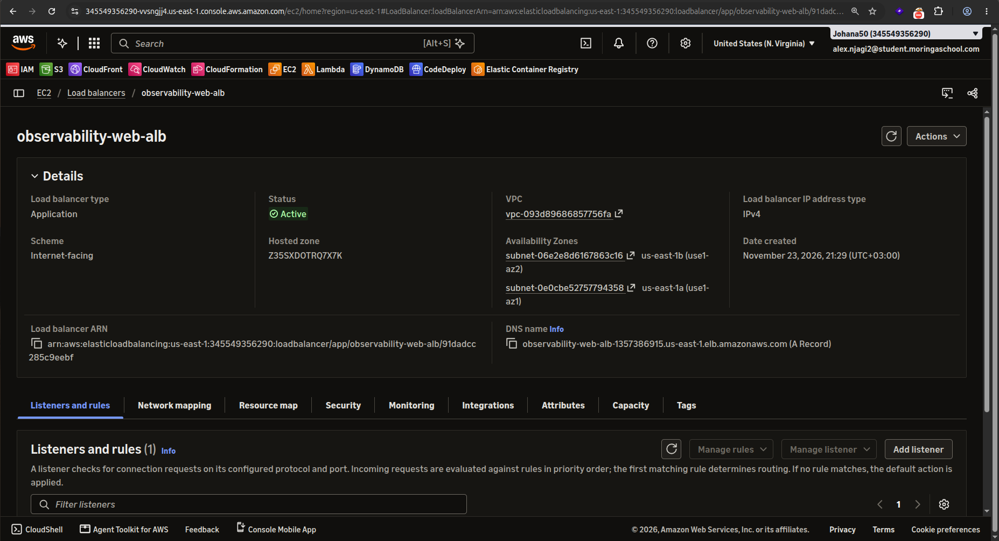

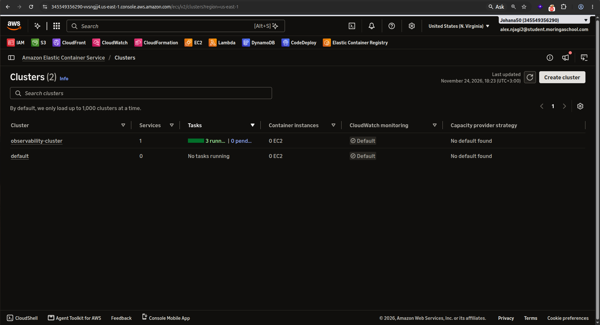

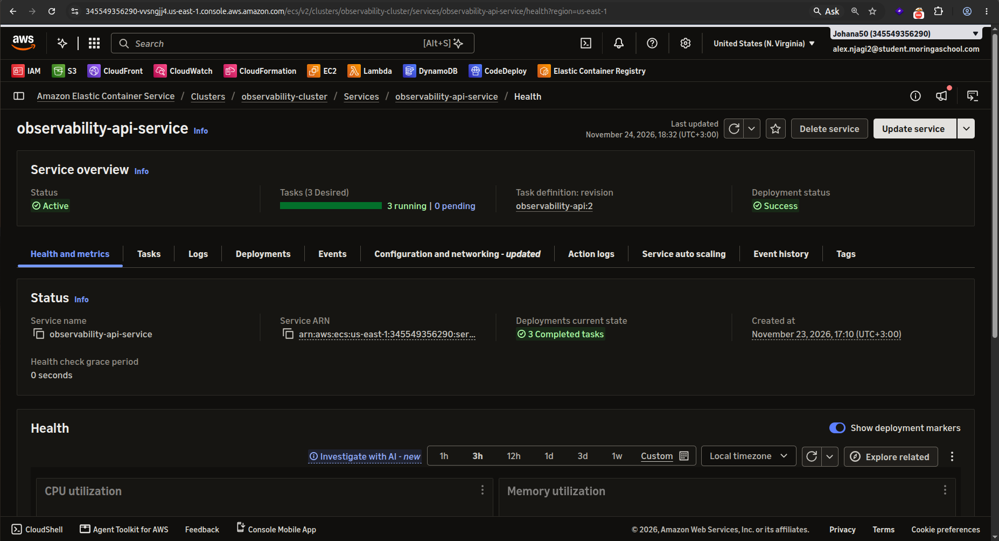

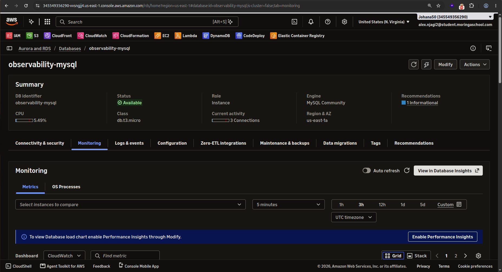

### CloudWatch Monitoring

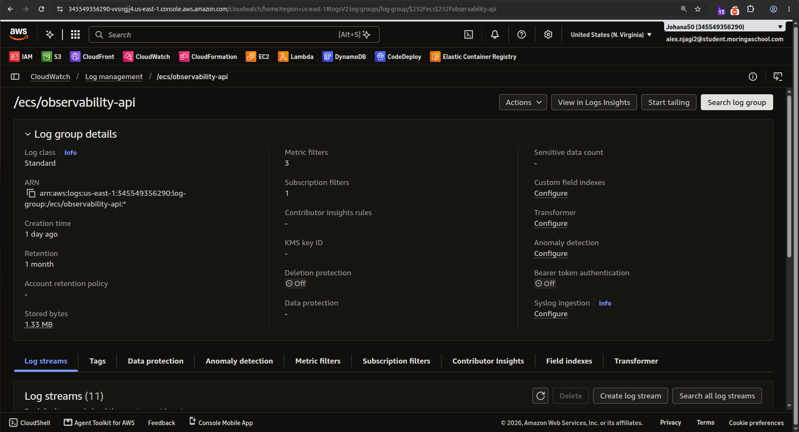

### Alarms and Automation

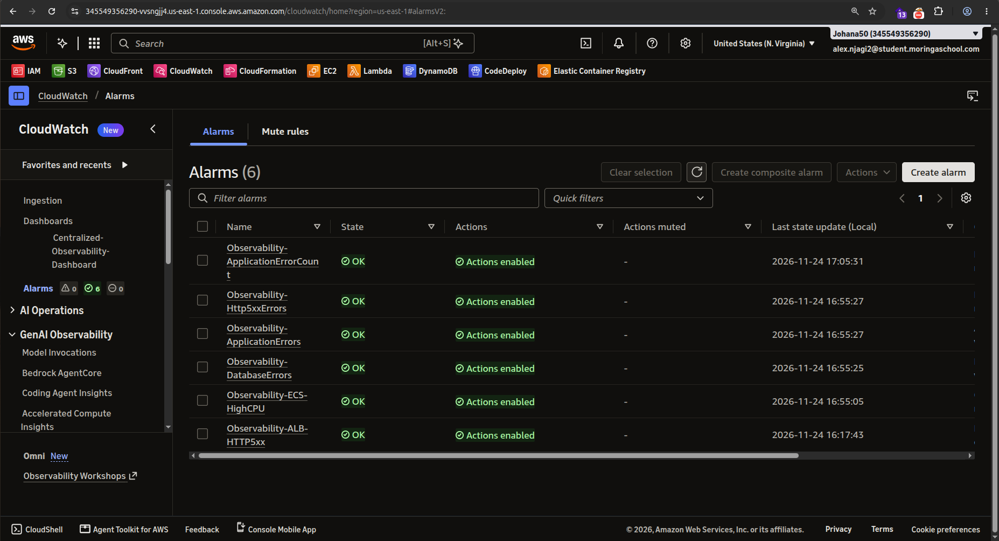

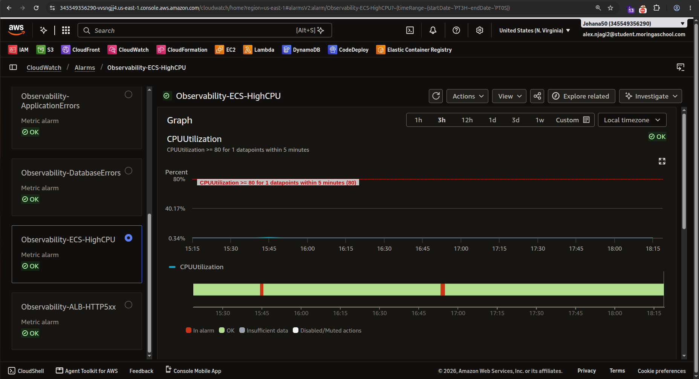

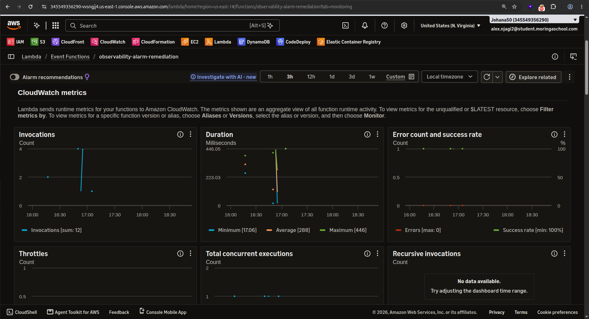

### Notifications

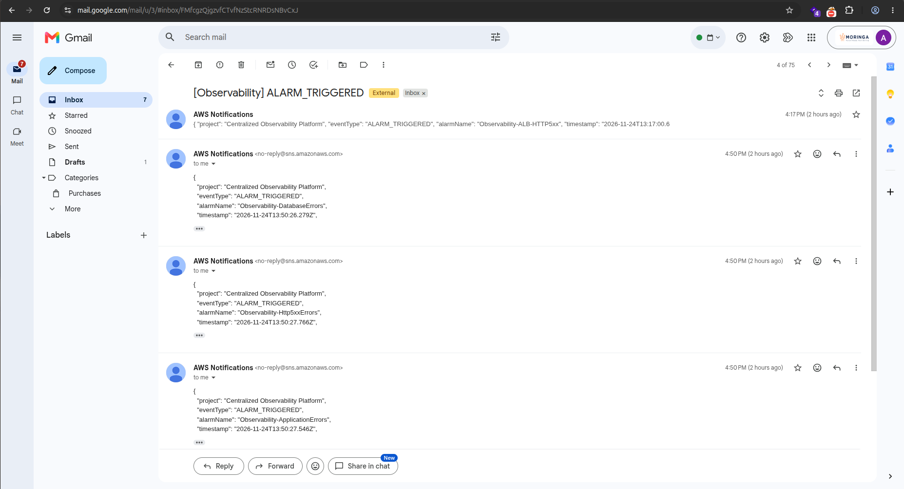

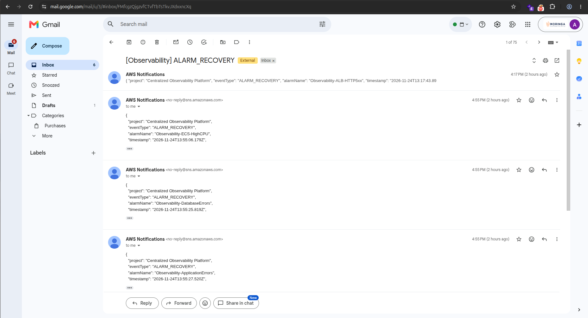

### Dashboard

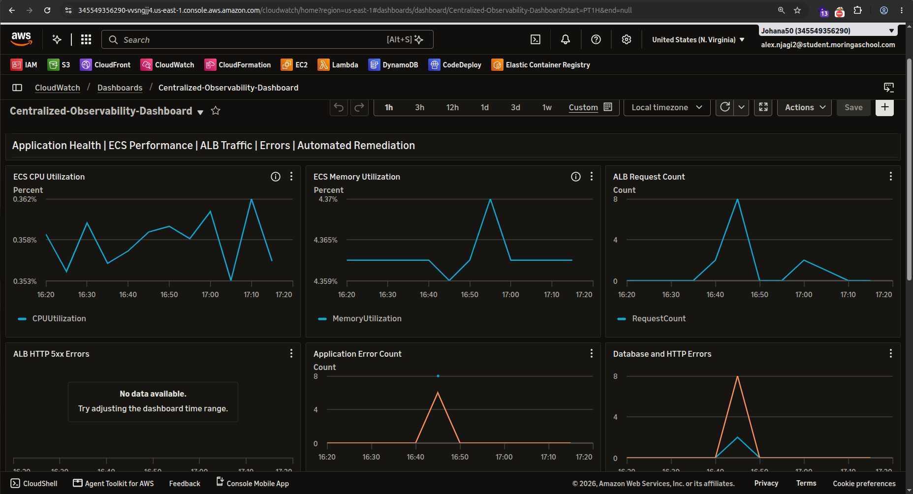

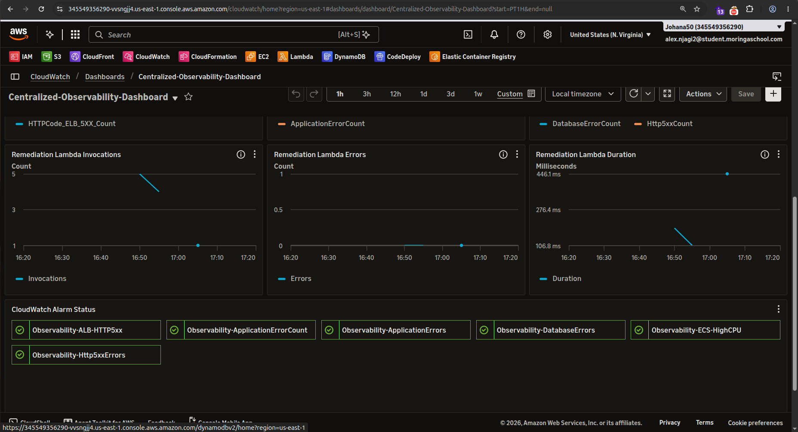

### Logs Insights

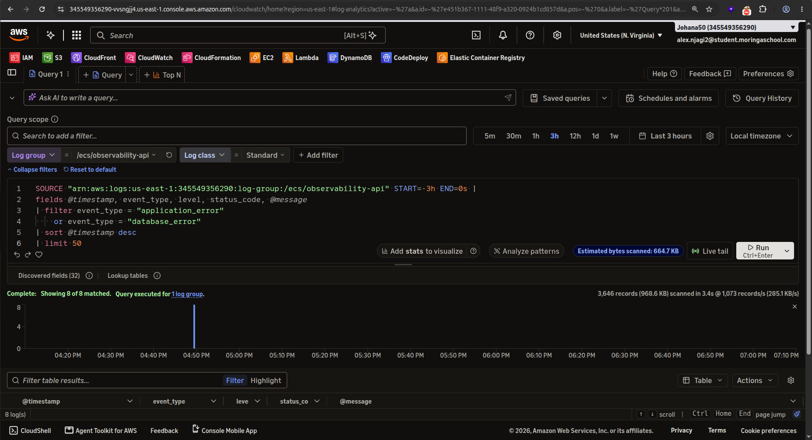

### Application

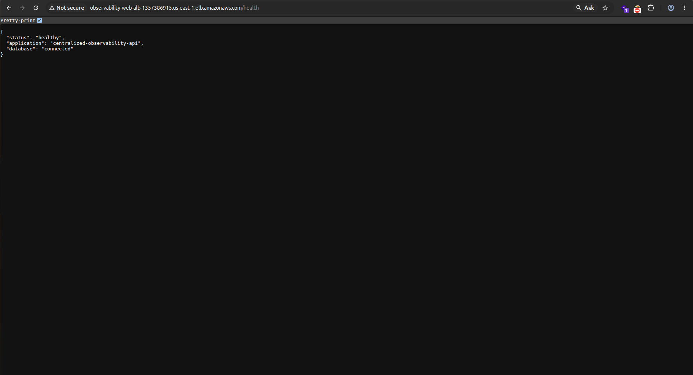

## 13. Final Technical Report

The detailed project report is available at:

[`docs/final-report.md`](docs/final-report.md)

It covers the architecture, monitoring design, Logs Insights, alarms, remediation tests, results, lessons learned, and future improvements.

## 14. Security and Cost Considerations

- Keep AWS credentials and `.env` files out of source control.
- Use IAM least-privilege policies for application and remediation roles.
- Keep the RDS database in private subnets.
- Review CloudWatch log retention and S3 lifecycle policies.
- Monitor ECS, RDS, EC2, CloudWatch, NAT Gateway, and data-transfer costs.
- Review AWS resources before deleting or modifying deployed infrastructure.

This project creates billable AWS resources. Check the AWS Billing console before and after running the environment.

## 15. Project Status

The implementation, monitoring configuration, automated remediation tests, screenshots, and technical report have been prepared as part of the project deliverables.

GitHub publication will follow after the final documentation and evidence review.

---

**Project:** Centralized Monitoring, Logging, and Automated Response for a Multi-Tier Application

**Cloud Provider:** Amazon Web Services

**Infrastructure as Code:** AWS CDK

**Application:** FastAPI, Python, MySQL

**Observability:** Amazon CloudWatch, OpenTelemetry, AWS X-Ray

**Automation:** Amazon EventBridge, AWS Lambda, Amazon SNS
